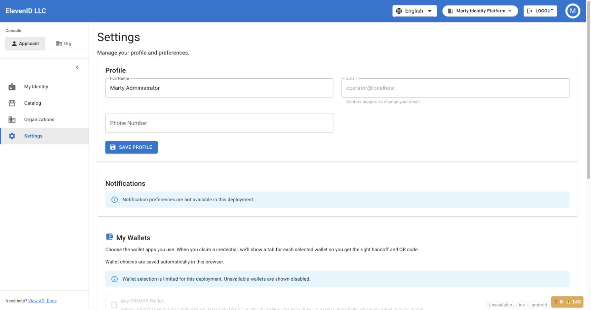
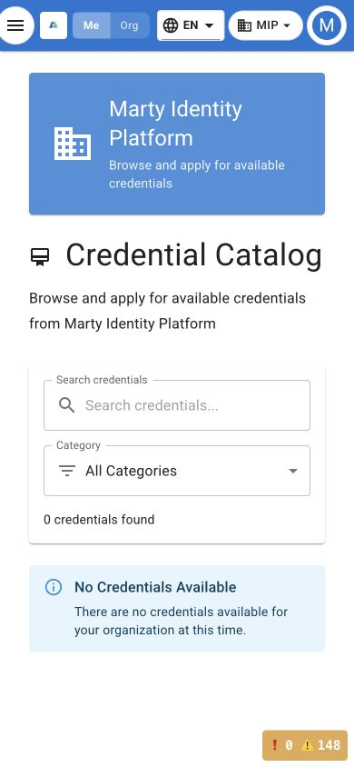

# Console UX audit — 2026-11-08

## Scope

This batch corrects issues found during an authenticated walkthrough of a disposable
development installation. Browser checks exercised the applicant and organization
surfaces, dashboard, membership list, organization settings, resource navigation,
creation form, and verification setup. The audit is bounded; it does not certify
every issuance, wallet, or credential lifecycle journey.

The companion [live reload guide](../kubernetes-ui-live-reload.md) describes the
repeatable, opt-in development configuration. Source changes were applied to the
running development checkout and the affected controls were exercised again.
Private infrastructure addresses and account/resource identifiers, credentials,
and operational receipts are excluded from this public report. Screenshots show
only synthetic development-account labels.

## Product fixes and browser verification

| Area | Observed defect | Correction and verification |
| --- | --- | --- |
| Dashboard invitations | Invite returned to Dashboard instead of opening an invitation | Both links now open Team with an invitation intent. The intent waits for current-organization roles and permission, then is consumed. Browser verified dialog opening, query cleanup, and Cancel without reopening; no invitation sent |
| Revocation navigation | A ready Revocation Profile row returned to Dashboard | The row now opens the registered Revocation Profiles page; browser retest passed |
| Flow navigation | Flow Instances returned to Dashboard | The tab now opens the operational Flow Instances page and its correct empty state; browser retest passed |
| Verification navigation | Evaluate VP returned to Dashboard; Start QR Verification opened an unconfigured generic flow wizard | Replaced these unsupported shortcuts with Verification Sessions. Browser verified the actual OID4VP session list |
| Missing translation | The build action displayed `Build flows.flowDefinition` | Added the singular label in all six console locales; browser verified Build Flow Definition after locale reload |
| Runtime readiness | Degraded issuance displayed All systems operational despite missing prerequisites | Details and actions now agree with the status. Browser verified the missing deployment explanation and Configure Deployment action |
| Issuer wording | Configuration evidence was described as signing-key validity | The card now describes the active template's issuer DID reference without claiming a cryptographic health check; browser retest passed |
| Service health | All services appeared Unknown despite reported gateway and issuance health | Read the readiness endpoint's actual service observations. Browser verified healthy gateway/issuance and explained Unknown for an unreported verifier |
| Critical events | An empty event feed asserted that all systems were operating normally | Empty state now says only that no critical events were reported; browser retest passed |
| Organization creation | Open membership left Discoverable off while submitting public visibility | UI and payload share the same rule. Browser verified Open/Approval force checked, disabled discovery with accurate copy, and Invite Only restores the prior preference |
| Creation entry point | Membership lists lacked Create Organization when enabled | Added an action using the same runtime flag as the creation route. Browser followed the action into the real form |
| Responsive layout | Creation fields and dashboard cards had uneven widths and ragged rows | Migrated the affected Grid sizing props and explanation spacing. Browser verified equal desktop columns, stacked phone cards, compact membership details, and no horizontal page overflow at phone width |
| Verification setup | Ad hoc mode hid the selectors and left Next disabled with an impossible post-creation editing promise | Removed the unsupported option. Browser verified the missing-policy explanation, disabled Next, and working Manage Presentation Policies action |

Source review also found that the inspection toggle never affected a supported
request field. It and its claims were removed while preserving purpose and issuer
selection. Saved active policies remain usable without a flow; complete catalog
loading prevents later active policies from being hidden by a first page of drafts.
Loading, failure, retry, and missing prerequisites remain distinct.

## Follow-up crawl

A second authenticated pass continued through the applicant catalog, profile,
wallet choices, identity view, organization setup, Team, API Keys, and Webhooks.
The fixes below are included in the same review batch. Browser observations are
distinguished from cases verified with controlled asynchronous test responses.

| Area | Defect and correction | Verification |
| --- | --- | --- |
| Console mode switch | Clearing the selected organization before the router transition let the previous org route redirect Applicant mode to org setup. Mode, selection, and navigation now share one React transition | Reproduced in the browser and in a composed provider/guard test with a suspended destination. Browser retest reached Catalog; switching back reached Dashboard. Tests also cover failed preference persistence |
| Organization setup | Existing members were told to join an organization and that this was necessary to access applicant credentials | Conditional copy now distinguishes choosing an existing console membership from obtaining console access; creation guidance respects the feature flag. Six locales updated and tested |
| Profile settings | Notification switches did not persist, Save Settings implied unrelated settings were saved, and fallback profile data could be submitted after a load failure | Unsupported switches replaced by an availability explanation; Save profile is inside the profile panel. Load failures block saving and offer Retry. Browser saved a temporary development-account display name, confirmed persistence after reload, then restored the original name |
| Wallet choices | Choices lacked accessible names and did not explain their browser-local persistence | Associated checkbox labels, wrapping content, distinct load failure/Retry, and accurate automatic-save copy. Browser verified the labels and guidance; keyboard and failure cases are regression-tested |
| Credential catalog | A genuinely empty catalog told users to adjust filters; loading and failed requests showed a false zero count | Separate unavailable, filtered, loading, and error states; Clear filters preserves Canvas scope, and Retry reloads in place. Browser verified the empty catalog, labeled controls, and phone layout |
| Catalog request scope | Late initial-organization or former-account requests could replace a newer Canvas catalog or application badges | Separate request generations and layout cleanup reject stale success, error, and completion results. Deferred tests cover Canvas transitions, account switches, and current requests still loading |
| Applicant shortcuts and credential actions | Apply opened the identity view, and several credential actions had no implemented operation | Apply now opens Catalog; identity links use the registered route. Removed inert presentation/download/renewal controls while retaining Details and real Claim. Source and regression tests cover populated credential states |
| Integration permissions | API key and webhook controls did not consistently check the exact action grant | Create/revoke and create/edit/delete/test use their native grants. Paired callback creation needs its own grant and rechecks it before the second request. One-time created secrets remain available through same-account permission refresh. Deferred permission tests cover these boundaries |
| Integration dialogs | Old organization/account operations and clipboard results could update replacement dialogs; failed actions lacked recoverable feedback | Account/org isolation, dialog generations, pending submission guards, inline errors, Retry, and accurate no-secret creation completion. Browser opened and canceled the forms; controlled tests cover writes, failures, permission loss, and delayed responses |
| Team and confirmations | Role pickers were not properly keyboard accessible; stale role/removal/revocation completions could affect a replacement organization; rejected confirmations could disappear | Native labeled role checkboxes, scoped completion guards, and retryable shared confirmation errors. Browser toggled an invitation role with Space and canceled without sending; deferred tests cover the mutation lifecycle |
| Native account identity | Permission state keyed legacy identity aliases while the native user response provides `user_id` | Native identity now takes precedence; account changes withdraw old grants immediately and reject late permission responses. Regression-tested |
| Sidebar accessibility | Desktop collapse and expand buttons appeared without an accessible name in the browser | Added explicit names and expansion state, confirmed by source inspection; existing navigation tests pass. This last change was not replayed on AWS after the browser connection ended |

Development checker fixes remove four ESLint errors without weakening input
validation. Independent exhaustive comparisons over all 65,536 UTF-16
code units confirmed that the three affected control-character rejection sets
remain identical.

### Browser evidence

The profile page now separates the working profile save from unsupported
notification preferences and browser-local wallet choices:

The phone catalog has labeled controls and an accurate empty state. Its page
content fits the viewport without horizontal overflow:

## Organization scope and asynchronous behavior

The invitation and verification workflows now reject stale organization data.
The Team action waits for its own resolved permission and current roles, even if
an independent permission gate resolves first. Organization changes close the
verification wizard and clear prior sessions. Delayed session creation, issuer
lookup, and session-list success/error results cannot update a replacement
organization or dialog. Closing during creation also resets loading on reopen.
These cases are covered by deferred-response regressions.

Runtime readiness validates all six required wire flags as actual booleans.
Missing fields and malformed values have distinct diagnostics; a string such as
`"false"` cannot be coerced into a ready state.

## Development support

The Helm development overlay serves Vite and its reload connection through the
installation's existing HTTPS origin. Development mode is opt-in, source mounts
are read-only, temporary volumes are bounded, and Node receives no service-account
or server credentials. The default static serving configuration is preserved.
The public organization-creation flag now reaches the UI explicitly, matching the
backend setting. The development memory limit accommodates the existing code
checkers; checks were not disabled to obtain a working development page.

The follow-up reproduced an out-of-memory termination at the previous 2 GiB
development-container limit during an in-process configuration reload. A process
snapshot then confirmed a native TypeScript watcher leak: two watchers remained
after one reload, each using roughly 1 GiB. Forced termination of the checker's
worker skipped the cleanup that owned its native child.

A version- and digest-checked installation patch now waits for checker startup,
stops and reaps its exact owned child, acknowledges cleanup, and then terminates
the worker. Both TypeScript and ESLint stay enabled; cleanup failures are logged.
The development-only 4 GiB limit on an 8 GiB node also accommodates Vite's
temporary overlap while preparing the replacement server.

After replacing the development pod to install the patch and clear the earlier
processes, the full AWS application had one native watcher. Two successive
configuration reloads each replaced that watcher and returned to exactly one.
Both checkers reported again after each reload, with zero TypeScript/ESLint
errors, 148 existing ESLint warnings, and no container restart or OOM termination.
A browser tab left on a transient gateway timeout during this rollout/reload
exercise recovered on reload; the signed-in identity view and catalog navigation
then worked. This verifies recovery and watcher cleanup, not uninterrupted
availability while replacing the development pod.

## Validation and review

- Final combined UI run: **437 tests passed across 32 files**.
- The existing **6 sidebar navigation tests passed** after the final accessible-name correction.
- Production TypeScript build check passed.
- Full UI ESLint passed with **zero errors and 148 existing warnings**.
- **33 Helm tests and 22 Node tests passed**: 9 development-origin/routing contracts and 13 checker-cleanup regressions.
- Independent default rendering compared 56 resources; only the intended UI public feature-flag environment entry differed.
- Both independent reviewers cleared the complete batch after their findings were corrected.
- The 34 production/deployment files deployed during the follow-up matched the local review copy on the development node by digest.
- Authenticated hot reload, corrected navigation, environment persistence, settings Cancel, dialogs, desktop layout, and phone layout were checked in the browser.

The combined test run includes the composed dashboard, parent verification page,
catalog loader, console-mode transitions, account/organization changes, and
permission-sensitive forms. Separate reviewer reruns overlap this count and are not
additional unique tests. A timing-dependent Team test now waits for the router's
committed pathname while retaining its permission and no-invitation assertions.

The checker integration regression retains actual TypeScript and ESLint error
diagnostics through three real Vite restarts, requires one replacement native
watcher after each, and requires zero after closing the server. It also checks
that an unrelated child survives. The Linux fixture uses tmpfs because native
TypeScript's fanotify cannot watch this executor's overlay filesystem; production
watch settings are unchanged. The focused suite is included in CI.

## Verification limits

The installed signed backend was `v1.1.274`. It predates the native organization
defaults endpoints merged in #1848, so defaults loading/saving could not be
verified end to end in this deployment. Organization profile details loaded,
display-name Cancel restored the original value, and environment selection
persisted after reload.

The earlier Keycloak changes in #1847 were already merged. This audit did not
exercise an actual Bitwarden extension/vault, so theme-level tests are not
reported as an extension autofill pass. Full wallet verification, credential
issuance, and creation/activation of all prerequisite resources remain outside
this bounded walkthrough. No organization, invitation, API key, or verification
session was created during the browser checks.
